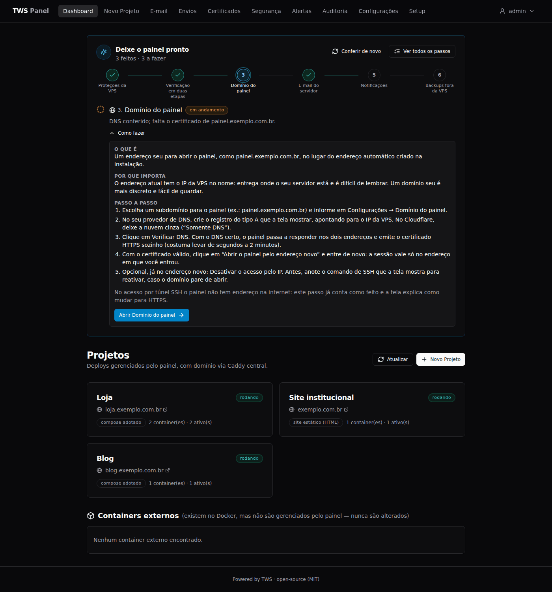
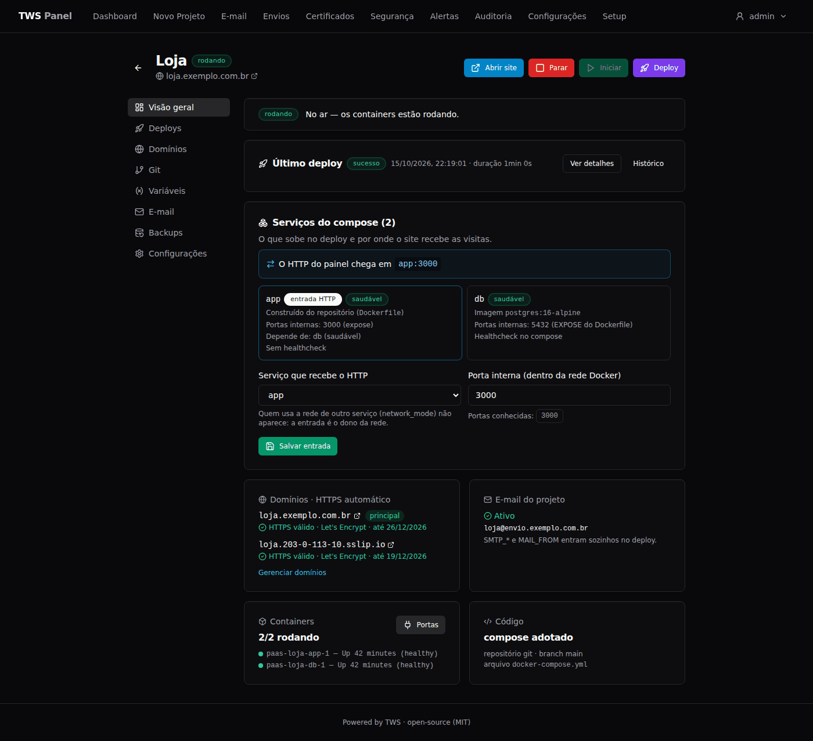
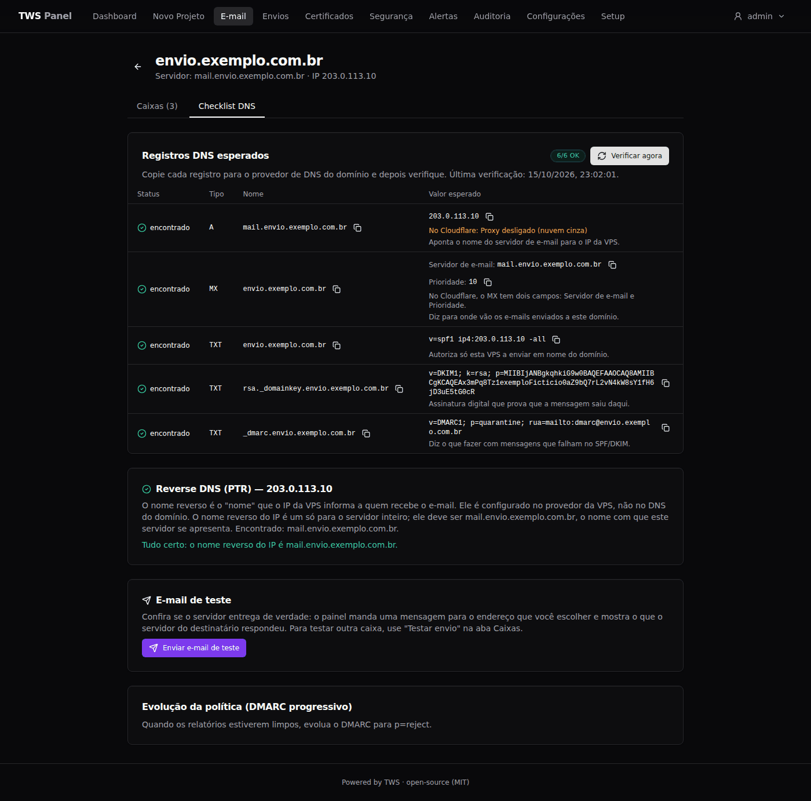
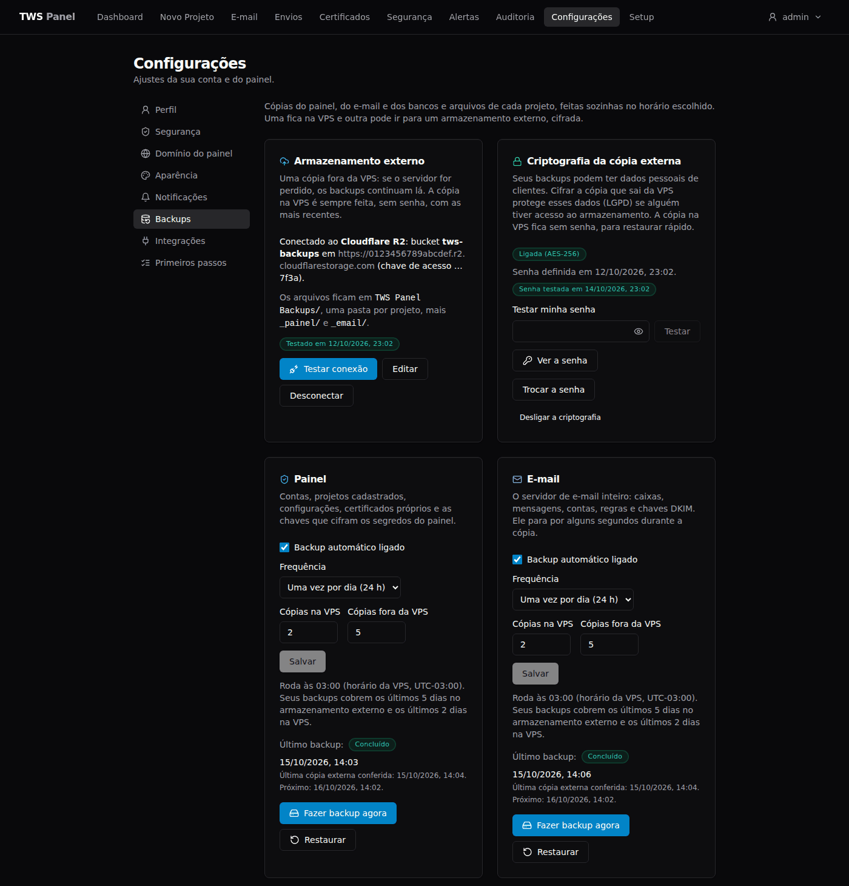

<div align="center">

🌐 **English** · [Português (Brasil)](README.pt-BR.md)

# TWS Panel

**Turn a rented Ubuntu VPS into your own hosting platform: deploy with automatic HTTPS, run your own email, and keep the server hardened, from one open-source panel.**

[](https://github.com/kelvindk9w/tws-panel/actions/workflows/ci.yml)
[](https://github.com/kelvindk9w/tws-panel/releases)
[](LICENSE)
[](ROADMAP.md)
[](CONTRIBUTING.md)

[Documentation](https://docs.tws.tec.br/) ·
[Install](#installation) ·
[Why TWS Panel](#why-tws-panel) ·
[Roadmap](ROADMAP.md) ·
[Contributing](CONTRIBUTING.md) ·
[Security](SECURITY.md)

</div>

<!-- screenshot: dashboard (docs/assets/dashboard.png). Replace with a fresh capture when the owner has one. -->


<!--
  Screenshots live in docs/assets/ (docs/assets/regenerar/COMO-REGENERAR.md, in Portuguese, explains
  how the existing ones are generated with fictional data). Planned captures (fictional data, English
  interface) are marked below; uncomment and point each one to its file when it exists.
-->
<!-- screenshot: dashboard-en -->
<!-- screenshot: deploy-live-log -->
<!-- screenshot: certificates-page -->
<!-- screenshot: hardening-wizard -->
<!-- screenshot: resources-tab -->
<!-- screenshot: ai-access-mcp -->

> [!NOTE]
> **TWS Panel is in beta.** The interface, the commands and the data formats may still change
> between versions. The [CHANGELOG](CHANGELOG.md) (in Portuguese) lists what changed in each one.

## Why TWS Panel

TWS used to rely on a hosting service to publish its clients' websites. One day, a simple change
to a site sat blocked for days with no answer from support. The server was not the problem; depending
on another company to configure everything was. TWS Panel is not a hosting company. It is the panel
that sets up the VPS that **you** rent, from the provider you choose, and it moves with you if you
switch providers.

- **Secure before it goes online.** A hardening wizard (based on Lynis, 8 phases, dry run, automatic
  rollback on the phases that touch access) runs during setup. Two-step verification, guardrails on
  every deploy, an alert center and an audit log are built in.
- **Your own email, built in.** A mail server (Stalwart) with DKIM, a DNS checklist the panel
  verifies, mailboxes, webmail, a deliverability view and per-project `SMTP_*` variables.
- **Updates without downtime.** Single-container projects start the new version next to the old one,
  wait for it to be healthy, then switch traffic. On by default for Next.js and static sites, opt-in
  for Dockerfile; compose projects show an "Updating" page instead.
- **English and Brazilian Portuguese**, in the panel and in the documentation (some messages written by the server are still in Portuguese).
- **Lightweight and non-invasive.** Fastify and JSON files, no external database. It reuses the Docker
  already on the machine and leaves what works alone.
- **Recoverable.** Encrypted off-site backups (Cloudflare R2 or other S3-compatible storage) and a
  "Restore from another server" flow to rebuild everything on a new VPS.
- **Open source (MIT)**, with an honest description of [what it does not protect against](https://docs.tws.tec.br/en/reference/security/).

## Features at a glance

- **Deploy** from a git repository (public or private), from GitHub or from a folder on the server: static sites, Next.js with a server (no Dockerfile needed), your own `Dockerfile`, or `docker-compose`.
- **Domains and HTTPS:** several domains per project, automatic Let's Encrypt certificates, a Certificates page, customer domains for SaaS and an automatic `*.sslip.io` address until you have your own.
- **Environments and variables:** production and sandbox from the same repository, encrypted variables, `.env` import.
- **Email:** mail server, mailboxes, webmail (Roundcube), project email, sending queue and blocklist checks.
- **Backups:** databases, volumes and folders, scheduled, on the VPS and off-site, with optional encryption and item-by-item restore.
- **Observability:** live deploy logs, a Logs tab per project, CPU/memory/disk/network history for the VPS and every project, with alerts.
- **Database tab** for PostgreSQL, MySQL and MariaDB projects.
- **Security:** hardening wizard, deploy guardrails, continuous monitoring, TOTP and recovery codes, API tokens with scope.
- **Notifications** by Telegram, email or both.
- **Web terminal** and a setup checklist on the Dashboard.
- **AI assistants (MCP)**, off by default: scoped tokens and an MCP endpoint you can turn on.

Each item is detailed in [Features in detail](#features-in-detail) and in the
[features guide](https://docs.tws.tec.br/en/guides/features/).

## How it compares

TWS Panel sits in the same family as self-hosted deploy platforms such as
[Coolify](https://coolify.io/), [Dokploy](https://dokploy.com/) and [CapRover](https://caprover.com/),
and those projects are mature and worth a look. The table only states what is widely known about
them and what we know about TWS Panel; things change fast, so **check their documentation** before
deciding.

| | TWS Panel | Coolify, Dokploy, CapRover |
|---|---|---|
| Self-hosted, open source, Docker-based | Yes (MIT) | Yes |
| Built-in mail server with DNS checklist and webmail | **Yes** | Not a core feature (check their docs) |
| Guided server hardening with rollback, in the setup wizard | **Yes** | Not a core feature (check their docs) |
| Zero-downtime switch for single-container projects | Yes | Generally supported (check their docs) |
| Panel and docs in English and Brazilian Portuguese | Yes | Check their docs |
| Managing several servers from one panel | No (one panel, one VPS) | Generally supported |
| One-click app templates | Planned, not available yet | Generally supported |
| Community size and maturity | Young project, beta | Larger, more mature |

Choose TWS Panel if you want one VPS that is hardened, serves your sites and sends its own email,
with a panel in your language. Choose another tool if you need a fleet of servers or a large
catalog of one-click apps today.

## Where to start

| Your situation | Go to |
|---|---|
| 🚀 **First installation.** You have never installed it, or want every step explained, from the rented VPS to a configured panel and a tested restore. | **[Step-by-step guide](https://docs.tws.tec.br/en/getting-started/installation/)**<br>Part 1 installs the panel; Part 2 configures it. |
| 🔁 **I reinstalled the VPS, or I am moving to another server.** You want the panel, the projects and the email back from the external backups. | **[Restore on a new VPS](https://docs.tws.tec.br/en/guides/restore-new-server/)** |
| ⚡ **I know what I am doing.** You have a clean Ubuntu VPS and a user with `sudo`. | **[Quick install, 1 command](#installation)** |

**SSH problems when connecting?** "REMOTE HOST IDENTIFICATION HAS CHANGED!" is expected after you
reinstall the VPS. See [what to do](https://docs.tws.tec.br/en/getting-started/installation/#host-identification-changed).

> The panel interface picks its language (English or Portuguese, Brazil) from your browser and has a
> selector in the header. Some messages written by the server are still in Portuguese. This README
> quotes screen names as they appear in the English interface.

## Features in detail

The [features guide](https://docs.tws.tec.br/en/guides/features/) covers each
item in detail.

### Deploy

- Deploy from a git repository (public or private), from your GitHub account or from a folder on the server.
- Detects static HTML, projects with a build step, a `Dockerfile` or a `docker-compose` file (an existing compose file is adopted, not rewritten).
- Multiple domains per project, with an automatic `*.sslip.io` address until you have your own.
- Multiple environments from the same repository, such as production and sandbox side by side.
- Encrypted environment variables, `.env` import, and deploys that stop when a required variable is missing.
- Port management per container: change, publish, remove or bulk-edit ports, with conflicts shown up front.
- Zero-downtime switch for single-container projects: the new version starts, is checked, and only then gets the traffic (on by default for Next.js and static sites, opt-in for Dockerfile; compose projects show an "Updating" page instead).
- Next.js with a server (SSR, API routes, middleware, ISR) without writing a Dockerfile.
- Live deploy logs, with a "Por que falhou" section (written by the server, still in Portuguese; it means "Why it failed") that shows the log of the service that became unhealthy.

### HTTPS and the panel domain

- Automatic certificates (Let's Encrypt) for the panel, the projects and email.
- A **Certificates** page with the status of each certificate, the likely cause when issuing fails, and a "Try issuing now" button.
- Bring your own certificate, with a check that the key and certificate match.
- A custom domain for the panel and, optionally, the ability to turn off access by IP.

### Email

- Your own mail server (Stalwart), with DKIM signing (RSA 2048).
- A DNS checklist that the panel verifies (A, MX, SPF, DKIM, DMARC and PTR), with PTR instructions per provider.
- Mailboxes with ready-to-use credentials for Outlook, Gmail or a phone, and a test email.
- Project email: a dedicated mailbox, with `SMTP_*` variables injected at deploy.
- Webmail (Roundcube) at `https://mail.<domain>/`.
- A **Sending** page for outgoing mail: queue, history, volume, blocklists and a deliverability score.

### Notifications

- Alerts by Telegram, email or both, covering security, deploys, certificates, blocklists, disk and backups.
- Messages leave out the VPS IP, repeated alerts are grouped, and an hourly limit applies.

### Backups

- Detects the databases (PostgreSQL, MySQL, MariaDB, MongoDB, Redis), volumes and folders in each project.
- Backups of the panel, the mail server and the projects as `.7z` files, with a schedule and retention.
- A copy on the VPS and another on Cloudflare R2 (or other S3-compatible storage), verified after upload.
- Optional encryption of the off-site copy, with a recovery kit.
- Restore item by item, or use "Restore from another server" to rebuild everything on a new VPS.

### Security

- A hardening wizard based on Lynis: 8 phases with a dry run, and automatic rollback on the phases that touch access.
- Deploy guardrails that block dangerous configurations (such as an exposed database port or a privileged container). Most blocking rules can be bypassed with an explicit, audited override; the ones that protect the panel's own isolation cannot.
- Continuous monitoring against a baseline, an alert center and an audit log.
- Resource monitoring with no extra agent: processor, memory, disk and network of the VPS and of every project, measured every minute, with traffic lights and 24-hour charts on the Dashboard, a **Resources** tab per project and alerts for tight memory, a crowded host, slow disk or a container that keeps restarting. It reads the host's `/proc` and `/sys/fs/cgroup` through two read-only mounts; the history retention is configurable.
- Checks of the mail server IP against email blocklists.
- Login with two-step verification (TOTP) and recovery codes.

### Observability, database and AI access

- A **Logs** tab per project (stdout and stderr of its containers, read-only, secrets masked on a best-effort basis).
- A **Database** tab for PostgreSQL, MySQL and MariaDB projects.
- API tokens with scope and expiry, and an MCP endpoint for AI assistants that ships **off**; both exclude sensitive areas such as the terminal and password/2FA changes.

### Web terminal and setup checklist

- A real shell on the server inside the panel, running as the user you choose at install time.
- A **Get the panel ready** checklist on the Dashboard that shows what is still left to configure.

## Installation

This is the short version for people who already know their way around a server. If you prefer
every step explained, follow the [step-by-step guide](https://docs.tws.tec.br/en/getting-started/installation/)
(see [Where to start](#where-to-start)).

**Requirements**

- A clean VPS running **Ubuntu 22.04 or 24.04 LTS**. Recommended minimum: 1 vCPU, 2 GB of RAM and 25 GB of disk.
- Ports **80 and 443** open to the internet (the HTTPS certificate depends on them).
- For email: port **25** unblocked by your provider (many block it on new accounts).
- Docker and everything else the panel needs are installed by the installer.

**One command**, run as a regular user with `sudo` (it installs git first if you do not have it):

```bash
sudo apt update && sudo apt install -y git \
  && sudo git clone --branch main https://github.com/kelvindk9w/tws-panel.git /opt/tws-panel \
  && sudo chown -R $USER:$USER /opt/tws-panel \
  && cd /opt/tws-panel && ./scripts/install.sh
```

The installer first checks the machine without changing anything. It then asks which user the
panel terminal should run as, installs Docker, starts the panel and prints the HTTPS address
with the setup token, for example `https://203-0-113-10.sslip.io/?token=...` (with your own IP).
Open it in your browser and follow the wizard: welcome, machine health, security (hardening) and
the administrator account.

> [!WARNING]
> **First time on a fresh VPS?** Create a regular user and install your SSH key *before* running
> the installer: the hardening phase turns off password login over SSH. The
> [step-by-step guide](https://docs.tws.tec.br/en/getting-started/installation/) walks through it, and the [security wizard guide](https://docs.tws.tec.br/en/getting-started/security-wizard/)
> explains how to confirm access without locking yourself out.

> [!WARNING]
> **Reinstalled the VPS and SSH complained "REMOTE HOST IDENTIFICATION HAS CHANGED!"?** That is
> expected: the VPS has a new identity. Run `ssh-keygen -R YOUR_IP` on your computer (with the VPS
> IP), connect again and answer `yes`. If you did **not** reinstall anything, do not continue and do
> not run `ssh-keygen -R`: check the IP and the provider's dashboard first. [Details](https://docs.tws.tec.br/en/getting-started/installation/#host-identification-changed).

<a id="after-installing"></a>

## After installing

On your first visit, the Dashboard shows the **Get the panel ready** checklist. The panel checks
the status of each step by itself, and each step has a "How to" section with a
button that opens the right screen.

| # | Step | What it is |
|---|---|---|
| 1 | **VPS hardening** | The hardening phases: updates, SSH with keys only, firewall, blocking of repeated login attempts and auditing. |
| 2 | **Two-factor authentication** | A 6-digit code from your phone, in addition to your password, to sign in to the panel. |
| 3 | **Panel domain** | An address of your own (`panel.example.com`) instead of the one that contains the IP. |
| 4 | **Server email** *(optional)* | A mail server on the VPS so your projects can send email. |
| 5 | **Notifications** *(optional)* | Telegram or email alerts when something needs your attention. |
| 6 | **Off-VPS backups** *(optional)* | An encrypted copy on Cloudflare R2 (or other S3-compatible storage), so you can recover everything on a new VPS. |

Optional steps can be dismissed with "I won't use this". The whole checklist is
also available under **Settings → Getting started**.

Prefer one ordered walkthrough, from the rented VPS to a first project online and a tested restore?
Follow the [step-by-step guide](https://docs.tws.tec.br/en/getting-started/installation/) (Part 2 covers this checklist and more).

<table>
  <tr>
    <td></td>
    <td></td>
    <td></td>
  </tr>
  <tr>
    <td align="center">Project</td>
    <td align="center">Email with verified DNS</td>
    <td align="center">Backups</td>
  </tr>
</table>

## Scope and trade-offs

- **One panel, one VPS.** Managing several servers from one panel is not supported (see the [roadmap](ROADMAP.md)).
- **It needs privileged access to the server.** The web terminal is a real shell on the VPS, and
  the Docker socket mounted into the panel is equivalent to root. This is by design. The
  [security model](https://docs.tws.tec.br/en/reference/security/) explains it, along with what the
  project does **not** protect.
- **Built for a clean Ubuntu LTS VPS.** The installer checks the machine first and asks for
  confirmation if it finds other services in the way.

## Documentation

The documentation website is at **<https://docs.tws.tec.br/>** (English and Portuguese).
The same pages can also be read in this repository, under [`site/src/content/docs/`](site/src/content/docs/).

| Guide | Content |
|---|---|
| [Step-by-step guide](https://docs.tws.tec.br/en/getting-started/installation/) | **Start here for a first installation.** Part 1 installs the panel on a clean VPS, with every command explained; Part 2 configures it, up to a tested restore |
| [Restore on a new VPS](https://docs.tws.tec.br/en/guides/restore-new-server/) | For when you reinstalled the VPS or are moving to another server: the panel, projects and email back from the external backups |
| [Security wizard](https://docs.tws.tec.br/en/getting-started/security-wizard/) | The 8 hardening phases, and how to confirm access without locking yourself out |
| [Features](https://docs.tws.tec.br/en/guides/features/) | What each module does, in detail |
| [Prepare your project](https://docs.tws.tec.br/en/guides/prepare-project/) | What your repository needs to be published: how the panel decides, ready-made recipes, variables, blocking rules and a checklist |
| [Operations](https://docs.tws.tec.br/en/guides/operations/) | Updating, useful commands, emergency scripts, the projects folder, and the terminal user and port |
| [Lost access](https://docs.tws.tec.br/en/guides/recover-access/) | Lost password, phone, SSH key or panel domain, and how to get back in |
| [AI access](https://docs.tws.tec.br/en/guides/ai-access/) | API tokens with scope for scripts and AI assistants: create, use, revoke, and what no token can ever do |
| [Security model](https://docs.tws.tec.br/en/reference/security/) | What the panel protects and what it requires |
| [Production](https://docs.tws.tec.br/en/guides/production/) and [troubleshooting](https://docs.tws.tec.br/en/guides/troubleshooting/) | Email ports, PTR and UFW; blocked port 25, email going to spam, certificates that fail to issue |
| [Local development](https://docs.tws.tec.br/en/development/local-development/) | Local development mode and architecture |
| [Help and feedback](https://docs.tws.tec.br/en/guides/help/) | Where to ask, report a bug, suggest something or reach us, and what to include |
| [Docs folder](docs/README.md) | Internal specs, research notes and the README images |

<a id="help-and-feedback"></a>

## Help and feedback

| You want to | Go to |
|---|---|
| Ask a question | [Discussions](https://github.com/kelvindk9w/tws-panel/discussions) |
| Report a bug | [Bug report](https://github.com/kelvindk9w/tws-panel/issues/new?template=bug_report.yml) |
| Suggest something | [Feature request](https://github.com/kelvindk9w/tws-panel/issues/new?template=feature_request.yml) or [Discussions](https://github.com/kelvindk9w/tws-panel/discussions) |
| Report a security problem | Privately, through a [security advisory](https://github.com/kelvindk9w/tws-panel/security/advisories/new) (see [SECURITY.md](SECURITY.md)). Do not open a public issue. |
| Reach us without a GitHub account | [contato@tws.tec.br](mailto:contato@tws.tec.br) |

In a bug report, include the panel version, the operating system of the VPS, the interface language
and the steps to reproduce it. **Do not paste logs without reviewing them first:** they can contain
domains, IP addresses and tokens. Replace domains with `example.com` and IP addresses with
`203.0.113.10`. The page [Help and feedback](https://docs.tws.tec.br/en/guides/help/) explains how.

## Security

Found a vulnerability? **Do not open a public issue.** [SECURITY.md](SECURITY.md) explains how to
report it privately.

## Roadmap

[ROADMAP.md](ROADMAP.md) lists what exists today and what is planned, without dates.

## Contributing

Contributions are welcome. [CONTRIBUTING.md](CONTRIBUTING.md) covers the local setup, the tests, the
project standards and the pull request flow. To run the panel on your own computer, see the
[local development guide](https://docs.tws.tec.br/en/development/local-development/).
Everyone taking part is expected to follow the [Code of Conduct](CODE_OF_CONDUCT.md).

## About TWS

**TWS Panel** is maintained by **TWS**, a software company founded and run by **Kelvin Medeiros** (CEO).
TWS builds custom web solutions, systems and automations for clients. The project grew out of a
problem the company had itself, and was then opened to the community under the MIT license.

- Website: [tws.tec.br](https://tws.tec.br/)
- Email: [contato@tws.tec.br](mailto:contato@tws.tec.br)
- LinkedIn: [Kelvin Medeiros](https://www.linkedin.com/in/kelvin-medeiros-37920487)

## License

[MIT](LICENSE) © 2026 TWS - Kelvin Medeiros
