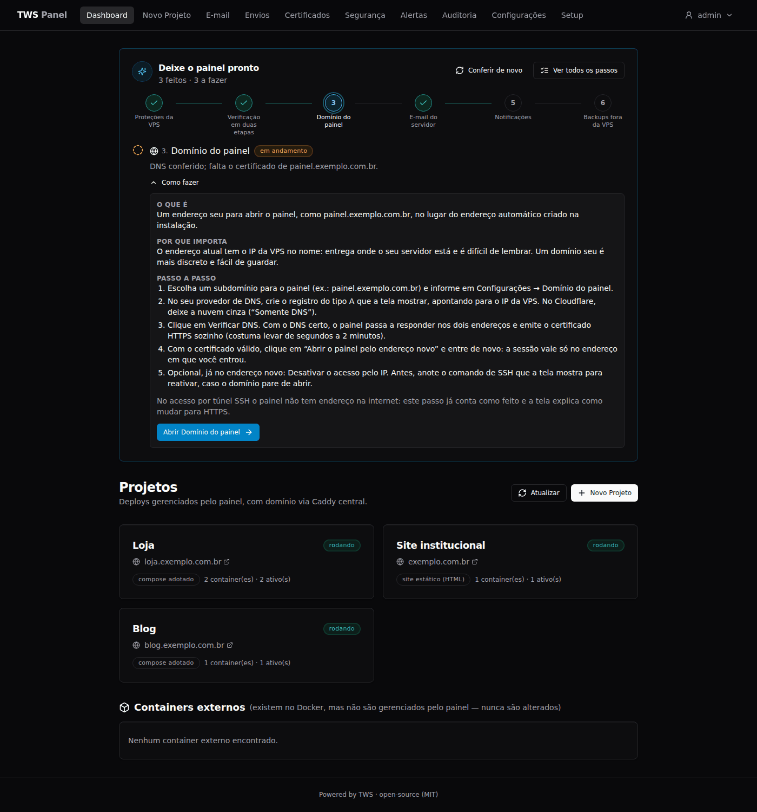
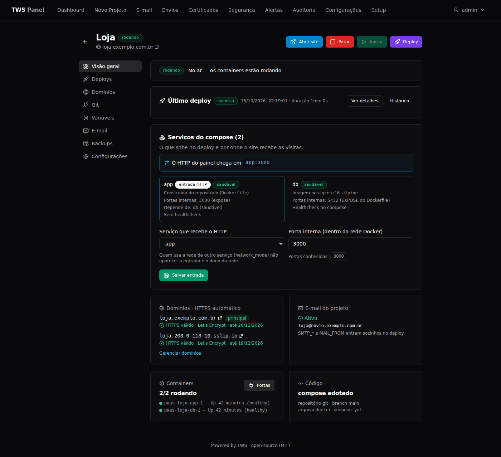
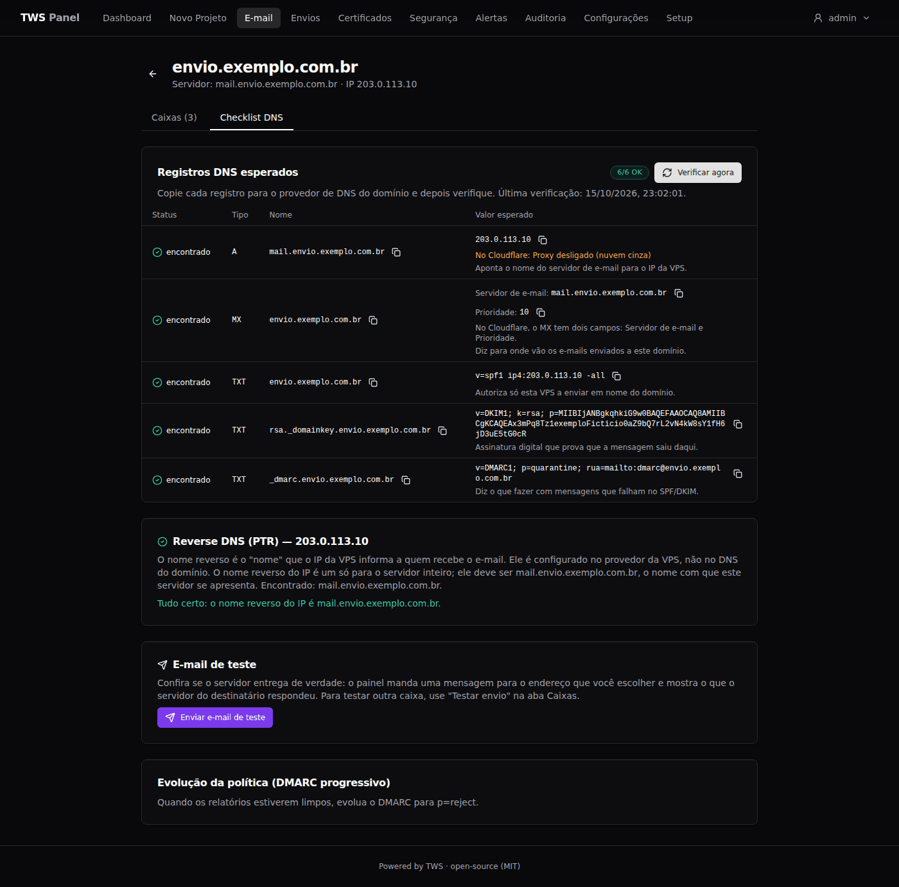
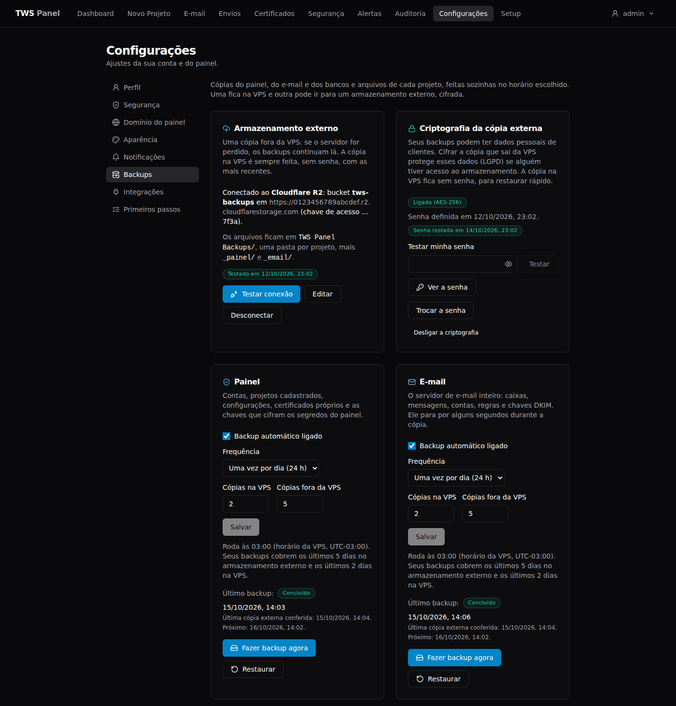

<div align="center">

🌐 [English](README.md) · **Português (Brasil)**

# TWS Panel

**Transforme uma VPS Ubuntu alugada na sua própria plataforma de hospedagem: deploy com HTTPS automático, e-mail próprio e servidor protegido, tudo em um painel open source.**

[](https://github.com/kelvindk9w/tws-panel/actions/workflows/ci.yml)
[](https://github.com/kelvindk9w/tws-panel/releases)
[](LICENSE)
[](ROADMAP.md)
[](docs/community/pt-BR/CONTRIBUTING.md)

[Documentação](https://docs.tws.tec.br/) ·
[Instalação](#instalação) ·
[Por que o TWS Panel](#por-que-o-tws-panel) ·
[Roadmap](ROADMAP.md) ·
[Contribuir](docs/community/pt-BR/CONTRIBUTING.md) ·
[Segurança](docs/community/pt-BR/SECURITY.md)

</div>

<!-- screenshot: dashboard (docs/assets/dashboard.png). Trocar por uma captura nova quando o dono tiver. -->


<!--
  As capturas ficam em docs/assets/ (docs/assets/regenerar/COMO-REGENERAR.md explica como as atuais
  são geradas com dados fictícios). Capturas planejadas (dados fictícios, interface em português)
  estão marcadas abaixo; descomente e aponte cada uma para o arquivo quando existir.
-->
<!-- screenshot: dashboard-pt -->
<!-- screenshot: deploy-log-ao-vivo -->
<!-- screenshot: pagina-certificados -->
<!-- screenshot: wizard-hardening -->
<!-- screenshot: aba-recursos -->
<!-- screenshot: acesso-ia-mcp -->

> [!NOTE]
> **O TWS Panel está em beta.** A interface, os comandos e os formatos de dados ainda podem mudar
> entre versões. O [CHANGELOG](CHANGELOG.md) lista o que mudou em cada uma.

## Por que o TWS Panel

A TWS dependia de um serviço de hospedagem para publicar os sites dos seus clientes. Um dia, uma
mudança simples num site ficou parada por dias, sem resposta do suporte. O problema não era o
servidor: era depender de outra empresa para configurar tudo. O TWS Panel não é uma hospedagem. É
o painel que prepara a VPS que **você** contrata, no provedor que quiser, e que vai com você se
você trocar de provedor.

- **Seguro antes de entrar no ar.** Um wizard de hardening (baseado no Lynis, 8 fases, simulação e
  rollback automático nas fases que mexem no acesso) roda na configuração inicial. Verificação em
  duas etapas, guardrails em todo deploy, central de alertas e log de auditoria já vêm prontos.
- **E-mail próprio, embutido.** Servidor de e-mail (Stalwart) com DKIM, checklist de DNS que o
  painel verifica, caixas, webmail, entregabilidade e variáveis `SMTP_*` por projeto.
- **Atualização sem queda.** Projetos de um container sobem a versão nova ao lado da antiga,
  esperam ficar saudável e só então trocam o tráfego. Ligada por padrão no Next.js e em sites
  estáticos, opcional no Dockerfile; projetos compose mostram a página "Atualizando".
- **Português (Brasil) e inglês**, no painel e na documentação (algumas mensagens escritas pelo servidor ainda saem em português).
- **Leve e não invasivo.** Fastify e arquivos JSON, sem banco de dados externo. Reaproveita o Docker
  que já está na máquina e não mexe no que já funciona.
- **Recuperável.** Backups externos criptografados (Cloudflare R2 ou outro armazenamento compatível
  com S3) e "Restaurar de outro servidor" para reconstruir tudo numa VPS nova.
- **Open source (MIT)**, com uma descrição honesta do [que ele não protege](https://docs.tws.tec.br/pt-br/reference/security/).

## Recursos em resumo

- **Deploy** a partir de um repositório git (público ou privado), do GitHub ou de uma pasta do servidor: sites estáticos, Next.js com servidor (sem precisar de Dockerfile), `Dockerfile` próprio ou `docker-compose`.
- **Domínios e HTTPS:** vários domínios por projeto, certificados Let's Encrypt automáticos, página Certificados, domínios de clientes para SaaS e um endereço `*.sslip.io` automático até você ter o seu.
- **Ambientes e variáveis:** produção e sandbox a partir do mesmo repositório, variáveis cifradas, importação de `.env`.
- **E-mail:** servidor de e-mail, caixas, webmail (Roundcube), e-mail do projeto, fila de envios e checagem de listas de bloqueio.
- **Backups:** bancos, volumes e pastas, agendados, na VPS e fora dela, com criptografia opcional e restauração item por item.
- **Observabilidade:** logs do deploy ao vivo, aba Logs por projeto, histórico de CPU, memória, disco e rede da VPS e de cada projeto, com alertas.
- **Aba Banco** para projetos com PostgreSQL, MySQL e MariaDB.
- **Segurança:** wizard de hardening, guardrails de deploy, monitoramento contínuo, TOTP e códigos de recuperação, tokens de API com escopo.
- **Notificações** pelo Telegram, por e-mail ou pelos dois.
- **Terminal web** e roteiro de configuração no Dashboard.
- **Assistentes de IA (MCP)**, desligado por padrão: tokens com escopo e um endpoint MCP que você pode ligar.

Cada item está detalhado em [Recursos em detalhe](#recursos-em-detalhe) e no
[guia de funcionalidades](https://docs.tws.tec.br/pt-br/guides/features/).

## Comparação

O TWS Panel é da mesma família das plataformas de deploy self-hosted como
[Coolify](https://coolify.io/), [Dokploy](https://dokploy.com/) e [CapRover](https://caprover.com/),
projetos maduros que valem a pena conhecer. A tabela só afirma o que é amplamente sabido sobre eles
e o que sabemos do TWS Panel; as coisas mudam rápido, então **confira a documentação deles** antes
de decidir.

| | TWS Panel | Coolify, Dokploy, CapRover |
|---|---|---|
| Self-hosted, open source, baseado em Docker | Sim (MIT) | Sim |
| Servidor de e-mail embutido, com checklist de DNS e webmail | **Sim** | Não é um recurso central (confira a documentação) |
| Hardening guiado do servidor, com rollback, no wizard inicial | **Sim** | Não é um recurso central (confira a documentação) |
| Troca sem queda em projetos de um container | Sim | Em geral, sim (confira a documentação) |
| Painel e documentação em português (Brasil) e inglês | Sim | Confira a documentação |
| Vários servidores num só painel | Não (um painel, uma VPS) | Em geral, sim |
| Modelos de aplicativos de um clique | Planejado, ainda não existe | Em geral, sim |
| Tamanho e maturidade da comunidade | Projeto novo, em beta | Maiores e mais maduros |

Escolha o TWS Panel se você quer uma VPS protegida, que serve seus sites e envia o próprio e-mail,
com um painel no seu idioma. Escolha outra ferramenta se hoje você precisa de uma frota de
servidores ou de um grande catálogo de aplicativos de um clique.

<a id="por-onde-começar"></a>

## Por onde começar

| Sua situação | Vá para |
|---|---|
| 🚀 **Primeira instalação.** Você nunca instalou, ou quer cada passo explicado, da VPS contratada ao painel configurado e a uma restauração testada. | **[Guia passo a passo](https://docs.tws.tec.br/pt-br/getting-started/installation/)**<br>A Parte 1 instala o painel; a Parte 2 o configura. |
| 🔁 **Reinstalei a VPS, ou estou mudando de servidor.** Você quer o painel, os projetos e o e-mail de volta a partir dos backups externos. | **[Restaurar numa VPS nova](https://docs.tws.tec.br/pt-br/guides/restore-new-server/)** |
| ⚡ **Já sei o que estou fazendo.** Você tem uma VPS Ubuntu limpa e um usuário com `sudo`. | **[Instalação rápida, 1 comando](#instalação)** |

**Problemas na hora de conectar por SSH?** O aviso "REMOTE HOST IDENTIFICATION HAS CHANGED!" é
esperado depois de reinstalar a VPS. Veja [o que fazer](https://docs.tws.tec.br/pt-br/getting-started/installation/#host-identification-changed).

> A interface do painel escolhe o idioma (português do Brasil ou inglês) pelo navegador e tem um seletor no cabeçalho. Algumas mensagens escritas pelo servidor ainda aparecem em português. O [ROADMAP](ROADMAP.md) está em inglês.

## Recursos em detalhe

O [guia de funcionalidades](https://docs.tws.tec.br/pt-br/guides/features/)
detalha cada item.

### Deploy

- Deploy a partir de um repositório git (público ou privado), da sua conta do GitHub ou de uma pasta do servidor.
- Detecta HTML estático, projetos com etapa de build, `Dockerfile` e `docker-compose` (um compose existente é adotado, não reescrito).
- Vários domínios por projeto, com um endereço automático `*.sslip.io` até você ter o seu.
- Vários ambientes a partir do mesmo repositório, como produção e sandbox lado a lado.
- Variáveis de ambiente cifradas, importação de `.env` e deploy interrompido quando falta uma variável obrigatória.
- Gerenciamento de portas por container: trocar, publicar, remover ou editar em lote, com os conflitos à vista.
- Troca sem queda em projetos de um container: a versão nova sobe, é conferida e só então recebe o tráfego (ligada por padrão no Next.js e em sites estáticos, opcional no Dockerfile; projetos compose mostram a página "Atualizando").
- Next.js com servidor (SSR, rotas de API, middleware, ISR) sem escrever um Dockerfile.
- Logs do deploy ao vivo e uma seção "Por que falhou" que mostra o log do serviço que ficou com problema.

### HTTPS e domínio do painel

- Certificados automáticos (Let's Encrypt) para o painel, os projetos e o e-mail.
- Página **Certificados** com o estado de cada certificado, a causa provável quando a emissão falha e o botão "Tentar emitir agora".
- Certificado próprio, com conferência de que a chave e o certificado combinam.
- Domínio próprio para o painel e, opcionalmente, a possibilidade de desativar o acesso pelo IP.

### E-mail

- Servidor de e-mail próprio (Stalwart), com assinatura DKIM (RSA 2048).
- Checklist de DNS que o painel verifica (A, MX, SPF, DKIM, DMARC e PTR), com instruções de PTR por provedor.
- Caixas de e-mail com credenciais prontas para Outlook, Gmail ou celular, e e-mail de teste.
- E-mail do projeto: uma caixa dedicada, com variáveis `SMTP_*` injetadas no deploy.
- Webmail (Roundcube) em `https://mail.<domínio>/`.
- Página **Envios**: fila, histórico, volume, listas de bloqueio e nota de entregabilidade.

### Notificações

- Alertas pelo Telegram, por e-mail ou pelos dois, sobre segurança, deploys, certificados, listas de bloqueio, disco e backups.
- As mensagens omitem o IP da VPS, alertas repetidos são agrupados e há um limite por hora.

### Backups

- Detecta os bancos de dados (PostgreSQL, MySQL, MariaDB, MongoDB, Redis), volumes e pastas de cada projeto.
- Backups do painel, do servidor de e-mail e dos projetos em arquivos `.7z`, com agenda e retenção.
- Uma cópia na VPS e outra no Cloudflare R2 (ou em outro armazenamento compatível com S3), conferida depois do envio.
- Criptografia opcional da cópia externa, com kit de recuperação.
- Restauração item por item, ou "Restaurar de outro servidor" para reconstruir tudo numa VPS nova.

### Segurança

- Wizard de hardening baseado no Lynis: 8 fases com simulação e rollback automático nas fases que mexem no acesso.
- Guardrails de deploy que bloqueiam configurações perigosas (como uma porta de banco de dados exposta ou um container privilegiado). A maioria dos bloqueios só pode ser contornada com um override explícito e auditado; os que protegem o isolamento do próprio painel não podem ser contornados.
- Monitoramento contínuo contra um baseline, central de alertas e log de auditoria.
- Monitoramento de recursos sem agente extra: processador, memória, disco e rede da VPS e de cada projeto, medidos a cada minuto, com semáforos e gráficos de 24 horas no Dashboard, aba **Recursos** em cada projeto e alertas para memória apertada, servidor disputado, disco lento ou container que não para de reiniciar. Lê o `/proc` e o `/sys/fs/cgroup` do servidor por duas montagens somente leitura; a retenção do histórico é configurável.
- Verificação do IP do servidor de e-mail em listas de bloqueio.
- Login com verificação em duas etapas (TOTP) e códigos de recuperação.

### Observabilidade, banco e acesso por IA

- Aba **Logs** em cada projeto (stdout e stderr dos containers, somente leitura, segredos mascarados na medida do possível).
- Aba **Banco** para projetos com PostgreSQL, MySQL e MariaDB.
- Tokens de API com escopo e validade, e um endpoint MCP para assistentes de IA que vem **desligado**; ambos deixam de fora áreas sensíveis, como o terminal e a troca de senha/2FA.

### Terminal web e roteiro de configuração

- Um shell real do servidor dentro do painel, executado com o usuário que você escolhe na instalação.
- Roteiro **Deixe o painel pronto** no Dashboard, que mostra o que ainda falta configurar.

## Instalação

Esta é a versão curta, para quem já se vira num servidor. Se você prefere cada passo explicado,
siga o [guia passo a passo](https://docs.tws.tec.br/pt-br/getting-started/installation/) (veja
[Por onde começar](#por-onde-começar)).

**Requisitos**

- Uma VPS limpa com **Ubuntu 22.04 ou 24.04 LTS**. Mínimo recomendado: 1 vCPU, 2 GB de RAM e 25 GB de disco.
- Portas **80 e 443** abertas para a internet (o certificado HTTPS depende delas).
- Para o e-mail: porta **25** liberada pelo provedor (muitos a bloqueiam em contas novas).
- O Docker e todo o resto de que o painel precisa são instalados pelo instalador.

**Um comando**, executado como usuário comum com `sudo` (ele instala o git antes, se você ainda não tiver):

```bash
sudo apt update && sudo apt install -y git \
  && sudo git clone --branch main https://github.com/kelvindk9w/tws-panel.git /opt/tws-panel \
  && sudo chown -R $USER:$USER /opt/tws-panel \
  && cd /opt/tws-panel && ./scripts/install.sh
```

O instalador começa conferindo a máquina, sem alterar nada. Depois pergunta com qual usuário o
terminal do painel deve abrir, instala o Docker, sobe o painel e mostra o endereço HTTPS com o
setup token, por exemplo `https://203-0-113-10.sslip.io/?token=...` (com o seu IP). Abra o
endereço no navegador e siga o assistente: boas-vindas, saúde da máquina, segurança (hardening) e
conta de administrador.

> [!WARNING]
> **Primeira vez numa VPS nova?** Crie um usuário comum e instale a sua chave SSH *antes* de rodar
> o instalador: a fase de hardening desliga o login por senha no SSH. O
> [guia passo a passo](https://docs.tws.tec.br/pt-br/getting-started/installation/) explica o
> processo, e o [guia do wizard de segurança](https://docs.tws.tec.br/pt-br/getting-started/security-wizard/)
> mostra como confirmar o acesso sem se trancar para fora.

> [!WARNING]
> **Reinstalou a VPS e o SSH reclamou "REMOTE HOST IDENTIFICATION HAS CHANGED!"?** É esperado: a
> VPS ganhou uma identificação nova. No seu computador, rode `ssh-keygen -R SEU_IP` (com o IP da
> VPS), conecte de novo e responda `yes`. Se você **não** reinstalou nada, não continue e não rode
> `ssh-keygen -R`: confira o IP e o painel do provedor primeiro. [Detalhes](https://docs.tws.tec.br/pt-br/getting-started/installation/#host-identification-changed).

<a id="depois-de-instalar"></a>

## Depois de instalar

No primeiro acesso, o Dashboard mostra o roteiro **Deixe o painel pronto**. O painel confere o
estado de cada passo sozinho, e cada passo tem uma seção "Como fazer" com um botão que abre a tela
certa.

| # | Passo | O que é |
|---|---|---|
| 1 | Proteções da VPS | As fases de hardening: atualizações, SSH só com chave, firewall, bloqueio de tentativas de login repetidas e auditoria. |
| 2 | Verificação em duas etapas | Um código de 6 dígitos do celular, além da senha, para entrar no painel. |
| 3 | Domínio do painel | Um endereço seu (`painel.exemplo.com.br`) no lugar do que contém o IP. |
| 4 | E-mail do servidor *(opcional)* | Um servidor de e-mail na VPS para os seus projetos enviarem mensagens. |
| 5 | Notificações *(opcional)* | Alertas pelo Telegram ou por e-mail quando algo precisa da sua atenção. |
| 6 | Backups fora da VPS *(opcional)* | Uma cópia cifrada no Cloudflare R2 (ou em outro armazenamento compatível com S3) para recuperar tudo numa VPS nova. |

Os passos opcionais aceitam "Não vou usar". O roteiro inteiro também fica em
**Configurações → Primeiros passos**.

Prefere um passo a passo único, da VPS contratada até o primeiro projeto no ar e um backup
restaurado? Siga o [guia passo a passo](https://docs.tws.tec.br/pt-br/getting-started/installation/) (a Parte 2 cobre este roteiro e mais).

<table>
  <tr>
    <td></td>
    <td></td>
    <td></td>
  </tr>
  <tr>
    <td align="center">Projeto</td>
    <td align="center">E-mail com DNS conferido</td>
    <td align="center">Backups</td>
  </tr>
</table>

## Escopo e limitações

- **Um painel, uma VPS.** Gerenciar vários servidores a partir de um só painel não é suportado (veja o [roadmap](ROADMAP.md)).
- **Exige acesso privilegiado ao servidor.** O terminal web é um shell real na VPS, e o socket do
  Docker montado no painel equivale a root. Isso é intencional. O
  [modelo de segurança](https://docs.tws.tec.br/pt-br/reference/security/) explica o assunto e o
  que o projeto **não** protege.
- **Feito para uma VPS Ubuntu LTS limpa.** O instalador confere a máquina antes e pede confirmação
  se encontrar outros serviços no caminho.

## Documentação

O site de documentação fica em **<https://docs.tws.tec.br/>** (inglês e português).
As mesmas páginas também podem ser lidas neste repositório, em [`site/src/content/docs/`](site/src/content/docs/).

| Guia | Conteúdo |
|---|---|
| [Guia passo a passo](https://docs.tws.tec.br/pt-br/getting-started/installation/) | **Comece aqui na primeira instalação.** A Parte 1 instala o painel numa VPS limpa, com cada comando explicado; a Parte 2 o configura, até uma restauração testada |
| [Restaurar numa VPS nova](https://docs.tws.tec.br/pt-br/guides/restore-new-server/) | Para quando você reinstalou a VPS ou está mudando de servidor: o painel, os projetos e o e-mail de volta a partir dos backups externos |
| [Wizard de segurança](https://docs.tws.tec.br/pt-br/getting-started/security-wizard/) | As 8 fases do hardening, e como confirmar o acesso sem se trancar para fora |
| [Funcionalidades](https://docs.tws.tec.br/pt-br/guides/features/) | O que cada módulo faz, em detalhe |
| [Preparar seu projeto](https://docs.tws.tec.br/pt-br/guides/prepare-project/) | O que o repositório precisa ter para ser publicado: como o painel decide, receitas prontas, variáveis, regras que barram o deploy e um checklist |
| [Operação](https://docs.tws.tec.br/pt-br/guides/operations/) | Atualizar, comandos úteis, scripts de emergência, a pasta dos projetos, e o usuário e a porta do terminal |
| [Perdi o acesso](https://docs.tws.tec.br/pt-br/guides/recover-access/) | Senha, celular, chave SSH ou domínio do painel perdidos, e como voltar a entrar |
| [Acesso por IA](https://docs.tws.tec.br/pt-br/guides/ai-access/) | Tokens de API com escopo para scripts e assistentes de IA: criar, usar, revogar e o que nenhum token faz |
| [Modelo de segurança](https://docs.tws.tec.br/pt-br/reference/security/) | O que o painel protege e o que ele exige |
| [Produção](https://docs.tws.tec.br/pt-br/guides/production/) e [problemas comuns](https://docs.tws.tec.br/pt-br/guides/troubleshooting/) | Portas de e-mail, PTR e UFW; porta 25 bloqueada, e-mail indo para o spam, certificado que não é emitido |
| [Desenvolvimento local](https://docs.tws.tec.br/pt-br/development/local-development/) | Modo de desenvolvimento local e arquitetura |
| [Ajuda e feedback](https://docs.tws.tec.br/pt-br/guides/help/) | Onde perguntar, relatar um bug, sugerir algo ou falar com a gente, e o que informar |
| [Pasta docs](docs/README.md) | Specs internas, notas de pesquisa e imagens do README |

<a id="ajuda-e-feedback"></a>

## Ajuda e feedback

| Você quer | Vá para |
|---|---|
| Tirar uma dúvida | [Discussions](https://github.com/kelvindk9w/tws-panel/discussions) |
| Relatar um bug | [Relato de bug](https://github.com/kelvindk9w/tws-panel/issues/new?template=bug_report.yml) |
| Sugerir algo | [Pedido de funcionalidade](https://github.com/kelvindk9w/tws-panel/issues/new?template=feature_request.yml) ou [Discussions](https://github.com/kelvindk9w/tws-panel/discussions) |
| Relatar um problema de segurança | Em privado, por um [relato de segurança](https://github.com/kelvindk9w/tws-panel/security/advisories/new) (veja o [SECURITY (pt-BR)](docs/community/pt-BR/SECURITY.md)). Não abra uma issue pública. |
| Falar com a gente sem conta no GitHub | [contato@tws.tec.br](mailto:contato@tws.tec.br) |

Num relato de bug, informe a versão do painel, o sistema operacional da VPS, o idioma da interface
e os passos para reproduzir. **Não cole logs sem revisar:** eles podem conter domínios, endereços
IP e tokens. Troque os domínios por `example.com` e os IPs por `203.0.113.10`. A página
[Ajuda e feedback](https://docs.tws.tec.br/pt-br/guides/help/) explica como.

## Segurança

Encontrou uma vulnerabilidade? **Não abra uma issue pública.** O
[SECURITY (pt-BR)](docs/community/pt-BR/SECURITY.md) explica como reportá-la de forma privada.

## Roadmap

O [ROADMAP.md](ROADMAP.md) (em inglês) lista o que já existe e o que está planejado, sem datas.

## Contribuir

Contribuições são bem-vindas. O [CONTRIBUTING (pt-BR)](docs/community/pt-BR/CONTRIBUTING.md) cobre o
setup local, os testes, os padrões do projeto e o fluxo de pull request. Para rodar o painel no seu
computador, veja o [guia de desenvolvimento local](https://docs.tws.tec.br/pt-br/development/local-development/).
Esperamos que todas as pessoas que participam sigam o [Código de Conduta](docs/community/pt-BR/CODE_OF_CONDUCT.md).

## Sobre a TWS

O **TWS Panel** é mantido pela **TWS**, uma software house fundada e dirigida por **Kelvin Medeiros** (CEO).
A TWS desenvolve soluções web, sistemas e automações sob medida para clientes. O projeto nasceu de
um problema que a própria empresa enfrentava e foi aberto à comunidade sob a licença MIT.

- Site: [tws.tec.br](https://tws.tec.br/)
- E-mail: [contato@tws.tec.br](mailto:contato@tws.tec.br)
- LinkedIn: [Kelvin Medeiros](https://www.linkedin.com/in/kelvin-medeiros-37920487)

## Licença

[MIT](LICENSE) © 2026 TWS - Kelvin Medeiros
