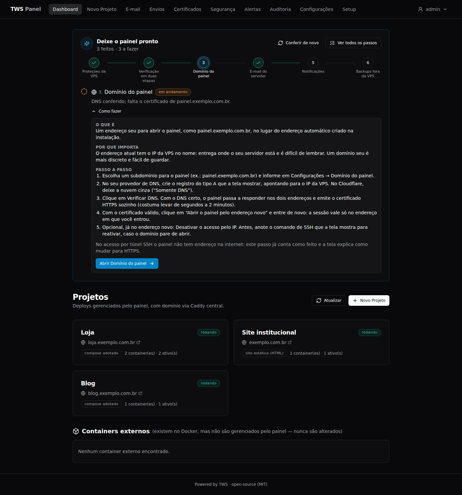
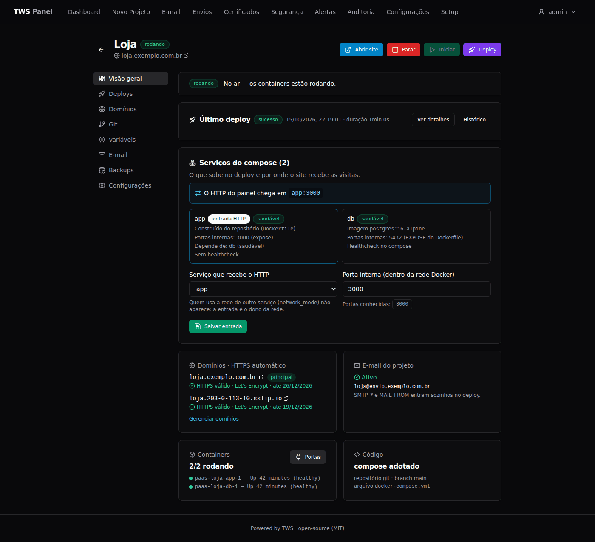
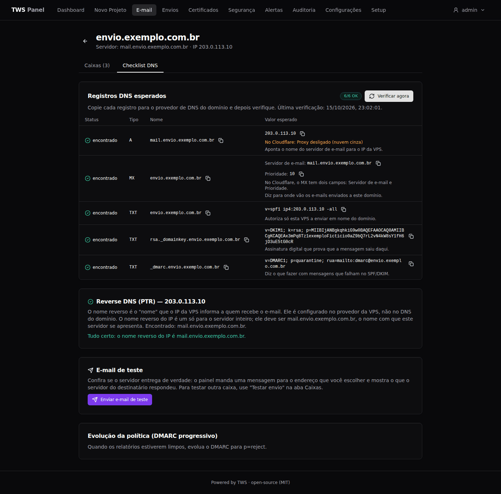
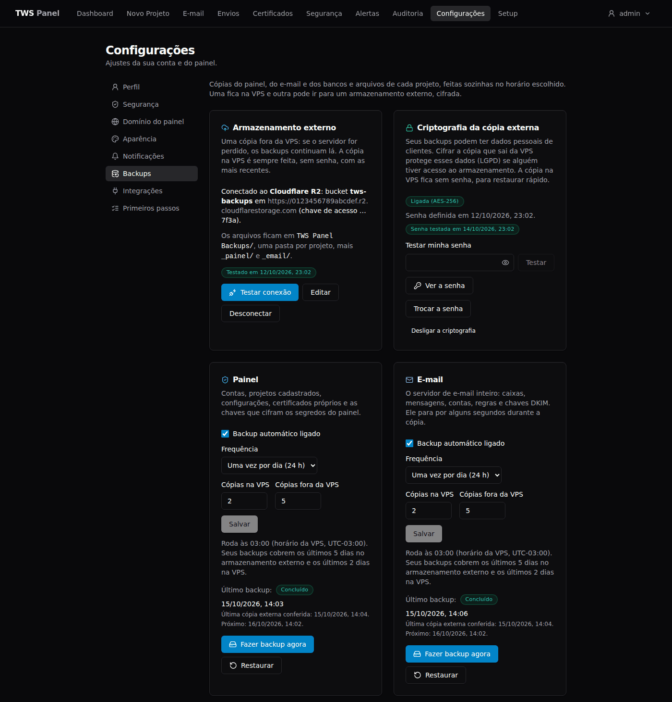

<div align="center">

# TWS Panel

**Transforme uma VPS Ubuntu na sua própria plataforma de hospedagem.**<br>
Proteja o servidor, publique projetos com HTTPS e tenha o seu próprio e-mail, tudo em um painel open source que você controla.

[](LICENSE)
[](ROADMAP.md)
[](https://github.com/kelvindk9w/tws-panel/actions/workflows/ci.yml)

[Documentação](https://kelvindk9w.github.io/tws-panel/) ·
[Instalação](#instalação) ·
[Roadmap](ROADMAP.md) ·
[Changelog](CHANGELOG.md) ·
[Contribuir](docs/community/pt-BR/CONTRIBUTING.md) ·
[English](README.md) | **Português (Brasil)**

</div>



> [!NOTE]
> **O TWS Panel está em beta.** A interface, os comandos e os formatos de dados ainda podem mudar
> entre versões. O [CHANGELOG](CHANGELOG.md) lista o que mudou em cada uma.
>
> A interface do painel está, por enquanto, só em português. A documentação está em inglês e em
> português (Brasil). O [ROADMAP](ROADMAP.md) está em inglês.

## Por que existe

A TWS dependia de um serviço de hospedagem para publicar os sites dos seus clientes. Um dia, uma
mudança simples num site ficou parada por dias, sem resposta do suporte. O problema não era o
servidor: era depender de outra empresa para configurar tudo. O TWS Panel não é uma hospedagem. É
o painel que prepara a VPS que **você** contrata, no provedor que quiser, e que vai com você se
você trocar de provedor.

**Princípios:**

- **Não invasivo:** reaproveita o Docker que já está na máquina e não mexe no que já funciona.
- **Segurança primeiro:** nada entra no ar antes do hardening.
- **Minimalista:** Fastify e arquivos JSON, sem banco de dados externo.
- **Open source:** licença MIT.

## O que faz

Uma visão geral. O [guia de funcionalidades](site/src/content/docs/pt-br/guides/features.md)
detalha cada item.

### Deploy

- Deploy a partir de um repositório git (público ou privado), da sua conta do GitHub ou de uma pasta do servidor.
- Detecta HTML estático, projetos com etapa de build, `Dockerfile` e `docker-compose` (um compose existente é adotado, não reescrito).
- Vários domínios por projeto, com um endereço automático `*.sslip.io` até você ter o seu.
- Vários ambientes a partir do mesmo repositório, como produção e sandbox lado a lado.
- Variáveis de ambiente cifradas, importação de `.env` e deploy interrompido quando falta uma variável obrigatória.
- Gerenciamento de portas por container: trocar, publicar, remover ou editar em lote, com os conflitos à vista.
- Logs do deploy ao vivo e a tela "Por que falhou", que mostra o log do serviço que ficou com problema.

### HTTPS e domínio do painel

- Certificados automáticos (Let's Encrypt) para o painel, os projetos e o e-mail.
- Página **Certificados** com o estado de cada certificado, a causa provável quando a emissão falha e o botão "Tentar emitir agora".
- Certificado próprio, com conferência de que a chave e o certificado combinam.
- Domínio próprio para o painel e, opcionalmente, a possibilidade de desativar o acesso pelo IP.

### E-mail

- Servidor de e-mail próprio (Stalwart), com assinatura DKIM (RSA 2048).
- Checklist de DNS que o painel verifica (A, MX, SPF, DKIM, DMARC e PTR), com instruções de PTR por provedor.
- Caixas de e-mail com credenciais prontas para Outlook, Gmail ou celular, e e-mail de teste.
- E-mail do projeto: uma caixa dedicada, com variáveis `SMTP_*` injetadas no deploy.
- Webmail (Roundcube) em `https://mail.<domínio>/`.
- Página **Envios**: fila, histórico, volume, listas de bloqueio e nota de entregabilidade.

### Notificações

- Alertas pelo Telegram, por e-mail ou pelos dois, sobre segurança, deploys, certificados, listas de bloqueio, disco e backups.
- As mensagens omitem o IP da VPS, alertas repetidos são agrupados e há um limite por hora.

### Backups

- Detecta os bancos de dados (PostgreSQL, MySQL, MariaDB, MongoDB, Redis), volumes e pastas de cada projeto.
- Backups do painel, do servidor de e-mail e dos projetos em arquivos `.7z`, com agenda e retenção.
- Uma cópia na VPS e outra no Cloudflare R2 (ou em outro armazenamento compatível com S3), conferida depois do envio.
- Criptografia opcional da cópia externa, com kit de recuperação.
- Restauração item por item, ou "Restaurar de outro servidor" para reconstruir tudo numa VPS nova.

### Segurança

- Wizard de hardening baseado no Lynis: 8 fases com simulação e rollback automático nas fases que mexem no acesso.
- Guardrails de deploy que bloqueiam configurações perigosas (como uma porta de banco de dados exposta ou um container privilegiado). A maioria dos bloqueios aceita um override explícito e auditado.
- Monitoramento contínuo contra um baseline, central de alertas e log de auditoria.
- Verificação do IP do servidor de e-mail em listas de bloqueio.
- Login com verificação em duas etapas (TOTP) e códigos de recuperação.

### Terminal web e roteiro de configuração

- Um shell real do servidor dentro do painel, executado com o usuário que você escolhe na instalação.
- Roteiro **Deixe o painel pronto** no Dashboard, que mostra o que ainda falta configurar.

## Instalação

**Requisitos**

- Uma VPS limpa com **Ubuntu 22.04 ou 24.04 LTS**. Mínimo recomendado: 1 vCPU, 2 GB de RAM e 25 GB de disco.
- Portas **80 e 443** abertas para a internet (o certificado HTTPS depende delas).
- Para o e-mail: porta **25** liberada pelo provedor (muitos a bloqueiam em contas novas).
- O Docker e todo o resto de que o painel precisa são instalados pelo instalador.

**Um comando**, executado como usuário comum com `sudo` (ele instala o git antes, se você ainda não tiver):

```bash
sudo apt update && sudo apt install -y git \
  && sudo git clone --branch main https://github.com/kelvindk9w/tws-panel.git /opt/tws-panel \
  && sudo chown -R $USER:$USER /opt/tws-panel \
  && cd /opt/tws-panel && ./scripts/install.sh
```

O instalador começa conferindo a máquina, sem alterar nada. Depois pergunta com qual usuário o
terminal do painel deve abrir, instala o Docker, sobe o painel e mostra o endereço HTTPS com o
setup token, por exemplo `https://203-0-113-10.sslip.io/?token=...` (com o seu IP). Abra o
endereço no navegador e siga o assistente: boas-vindas, saúde da máquina, segurança (hardening) e
conta de administrador.

> [!WARNING]
> **Primeira vez numa VPS nova?** Crie um usuário comum e instale a sua chave SSH *antes* de rodar
> o instalador: a fase de hardening desliga o login por senha no SSH. O
> [guia de instalação](site/src/content/docs/pt-br/getting-started/installation.md) explica o
> processo passo a passo, e o [guia do wizard de segurança](site/src/content/docs/pt-br/getting-started/security-wizard.md)
> mostra como confirmar o acesso sem se trancar para fora.

<a id="depois-de-instalar"></a>

## Depois de instalar

No primeiro acesso, o Dashboard mostra o roteiro **Deixe o painel pronto**. O painel confere o
estado de cada passo sozinho, e cada passo tem uma seção "Como fazer" com um botão que abre a tela
certa.

| # | Passo | O que é |
|---|---|---|
| 1 | Proteções da VPS | As fases de hardening: atualizações, SSH só com chave, firewall, bloqueio de tentativas de login repetidas e auditoria. |
| 2 | Verificação em duas etapas | Um código de 6 dígitos do celular, além da senha, para entrar no painel. |
| 3 | Domínio do painel | Um endereço seu (`painel.exemplo.com.br`) no lugar do que contém o IP. |
| 4 | E-mail do servidor *(opcional)* | Um servidor de e-mail na VPS para os seus projetos enviarem mensagens. |
| 5 | Notificações *(opcional)* | Alertas pelo Telegram ou por e-mail quando algo precisa da sua atenção. |
| 6 | Backups fora da VPS *(opcional)* | Uma cópia cifrada no Cloudflare R2 (ou em outro armazenamento compatível com S3) para recuperar tudo numa VPS nova. |

Os passos opcionais aceitam "Não vou usar". O roteiro inteiro também fica em
**Configurações → Primeiros passos**.

Prefere um passo a passo único, da VPS contratada até o primeiro projeto no ar e um backup
restaurado? Siga o guia [Do zero ao painel pronto](site/src/content/docs/pt-br/getting-started/complete-guide.md).

<table>
  <tr>
    <td></td>
    <td></td>
    <td></td>
  </tr>
  <tr>
    <td align="center">Projeto</td>
    <td align="center">E-mail com DNS conferido</td>
    <td align="center">Backups</td>
  </tr>
</table>

## Escopo e limitações

- **Um painel, uma VPS.** Gerenciar vários servidores a partir de um só painel não é suportado (veja o [roadmap](ROADMAP.md)).
- **Exige acesso privilegiado ao servidor.** O terminal web é um shell real na VPS, e o socket do
  Docker montado no painel equivale a root. Isso é intencional. O
  [modelo de segurança](site/src/content/docs/pt-br/reference/security.md) explica o assunto e o
  que o projeto **não** protege.
- **Feito para uma VPS Ubuntu LTS limpa.** O instalador confere a máquina antes e pede confirmação
  se encontrar outros serviços no caminho.

## Documentação

O site de documentação fica em **<https://kelvindk9w.github.io/tws-panel/>** (inglês e português).
As mesmas páginas estão neste repositório, em [`site/src/content/docs/`](site/src/content/docs/).

| Guia | Conteúdo |
|---|---|
| [Instalação](site/src/content/docs/pt-br/getting-started/installation.md) | Passo a passo numa VPS limpa (passos 1 a 8) |
| [Wizard de segurança](site/src/content/docs/pt-br/getting-started/security-wizard.md) | As 8 fases do hardening, e como confirmar o acesso sem se trancar para fora |
| [Do zero ao painel pronto](site/src/content/docs/pt-br/getting-started/complete-guide.md) | Um passo a passo único, da VPS contratada até um restore testado |
| [Funcionalidades](site/src/content/docs/pt-br/guides/features.md) | O que cada módulo faz, em detalhe |
| [Operação](site/src/content/docs/pt-br/guides/operations.md) | Atualizar, comandos úteis, scripts de emergência, a pasta dos projetos, e o usuário e a porta do terminal |
| [Perdi o acesso](site/src/content/docs/pt-br/guides/recover-access.md) | Senha, celular, chave SSH ou domínio do painel perdidos, e como voltar a entrar |
| [Modelo de segurança](site/src/content/docs/pt-br/reference/security.md) | O que o painel protege e o que ele exige |
| [Produção](site/src/content/docs/pt-br/guides/production.md) e [problemas comuns](site/src/content/docs/pt-br/guides/troubleshooting.md) | Portas de e-mail, PTR e UFW; porta 25 bloqueada, e-mail indo para o spam, certificado que não é emitido |
| [Desenvolvimento local](site/src/content/docs/pt-br/development/local-development.md) | Modo de desenvolvimento local e arquitetura |
| [Pasta docs](docs/README.md) | Specs internas, notas de pesquisa e imagens do README |

## Segurança

Encontrou uma vulnerabilidade? **Não abra uma issue pública.** O
[SECURITY (pt-BR)](docs/community/pt-BR/SECURITY.md) explica como reportá-la de forma privada.

## Roadmap

O [ROADMAP.md](ROADMAP.md) (em inglês) lista o que já existe e o que está planejado, sem datas.

## Contribuir

Contribuições são bem-vindas. O [CONTRIBUTING (pt-BR)](docs/community/pt-BR/CONTRIBUTING.md) cobre o
setup local, os testes, os padrões do projeto e o fluxo de pull request. Para rodar o painel no seu
computador, veja o [guia de desenvolvimento local](site/src/content/docs/pt-br/development/local-development.md).
Esperamos que todas as pessoas que participam sigam o [Código de Conduta](docs/community/pt-BR/CODE_OF_CONDUCT.md).

## Sobre a TWS

O **TWS Panel** é mantido pela **TWS**, uma software house fundada e liderada pelo CEO **Kelvin**.
A TWS desenvolve soluções web, sistemas e automações sob medida para clientes. O projeto nasceu de
um problema que a própria empresa enfrentava e foi aberto à comunidade sob a licença MIT.

- Site: [tws.tec.br](https://tws.tec.br/)
- E-mail: [contato@tws.tec.br](mailto:contato@tws.tec.br)
- LinkedIn: [Kelvin Medeiros](https://www.linkedin.com/in/kelvin-medeiros-37920487)

## Licença

[MIT](LICENSE) © 2026 TWS - Kelvin Medeiros
